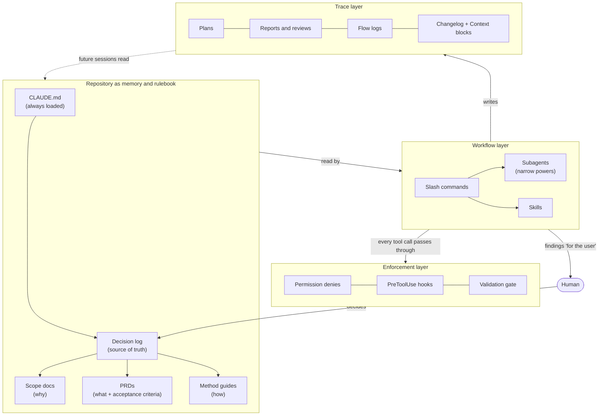
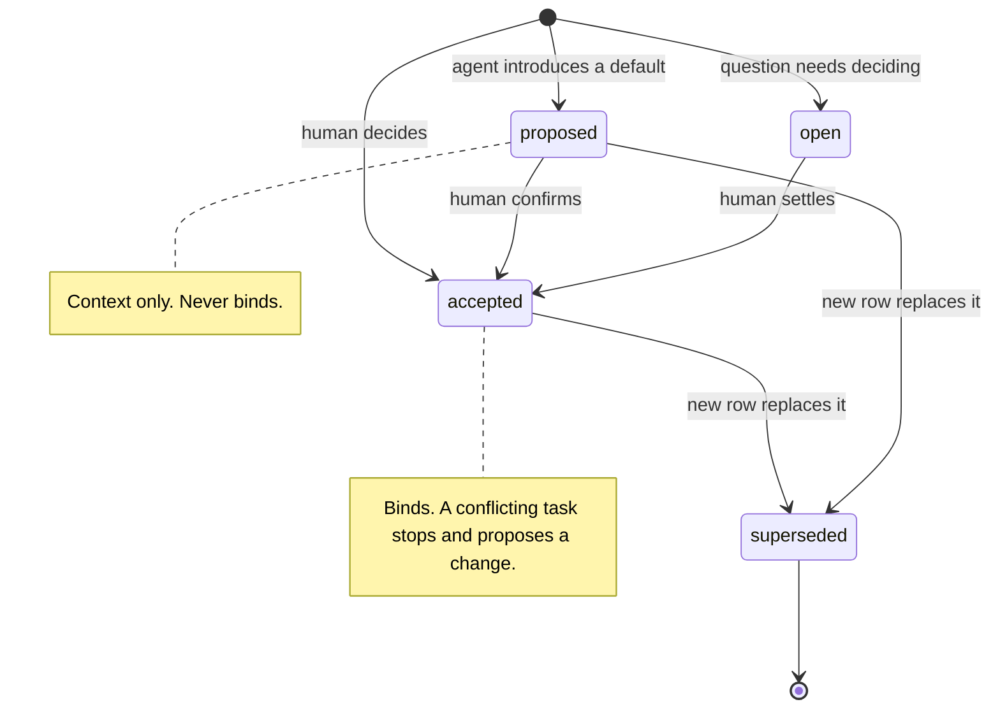
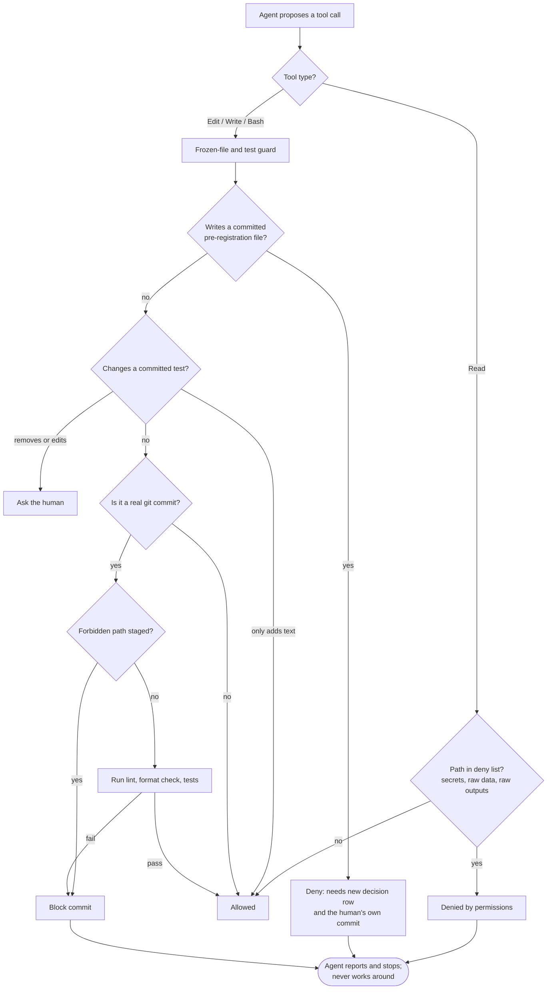
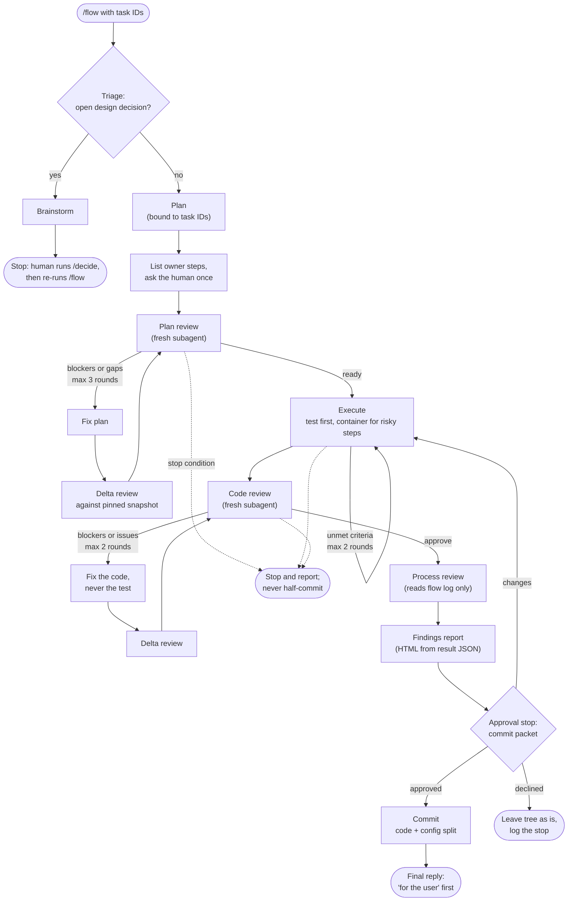
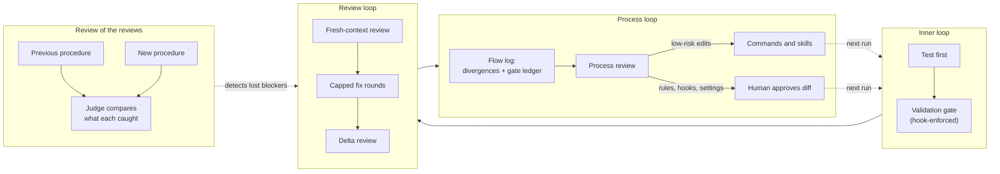

# Engineering a Harness for Agentic Research Work

*A case study in making coding agents reliable on work where mistakes are expensive.*

## The problem

I run coding agents on a research codebase with three properties that make naive agent use dangerous:

1. **Hostile data.** The dataset contains attack code. An agent that reads, prints, commits or executes it carelessly causes real harm.
2. **Pre-registered science.** Evaluation rules are frozen before results exist. An agent that "helpfully" adjusts a threshold or loosens a failing test invalidates the study.
3. **Long horizons.** The work spans many sessions and two studies. Agents have no memory between sessions, and decisions made in week one must still bind in week eight.

Prompting the agent to be careful does not solve this. A harness does: the files, commands, subagents and hooks around the model that decide what it can see, do and claim.

## Architecture at a glance

## Design principles

**1. Repository as memory and rulebook.** A short `CLAUDE.md` is loaded every session. It points at a decision log, which is the source of truth, and at scope docs (why), PRDs (what) and method guides (how). The agent reconstructs context from files, not from a previous conversation.

**2. A decision log with status semantics.** Every decision is a row with an ID, date, status and rationale pointer. `accepted` rows bind, `proposed` rows are context, `superseded` rows are history. An agent that invents a default must log it as `proposed`. When a task conflicts with an accepted row, the agent stops and proposes a specific change instead of choosing silently. This turns "the agent made a call nobody noticed" into a visible, reviewable event.

**3. Agents recommend, humans decide.** Design commands end with a ready-to-paste decision line, never a recorded decision. Every review step sorts findings into `fixed`, `not applied (why)` or `for the user`, and none is dropped silently.

**4. Enforce with code, not prose.** Rules that must hold are implemented as hooks and permissions (see below). Prose rules cover judgment calls.

**5. Fresh-context review.** Reviews run in subagents that see only an artefact path and task IDs, not the builder's conversation. Reviewing your own work in the same context shares its blind spots, so it does not count as a review.

**6. Done means verified.** A task is ticked only after its acceptance criteria pass with a command the agent actually ran, citing the execution report. Tests cannot be weakened to make a failure go away; the code is fixed.

**7. Every step leaves a trace.** Plans, execution reports, reviews, flow logs and per-commit changelog entries are files. Commits touching the AI layer carry a `Context:` block, so `git log` explains why a rule or command changed.

## Mechanisms

### Hooks and permissions (the hard guarantees)

- **Read denies** on secrets, raw data and raw outputs, so file tools cannot open them.
- **Frozen-file guard** (PreToolUse on file edits and Bash). It denies changes to committed pre-registration configs. It inspects shell routes too: redirects, `tee`, `sed -i`, `rm`, `mv`, `cp`, `git checkout`. Changing one requires a new decision row and the human's own commit.
- **Test-weakening guard.** Changes to committed tests prompt for confirmation. An edit that only adds text passes, so extending tests is frictionless and weakening them needs a human yes.
- **Commit gate.** A hook detects an actual `git commit` (not a mention of one), blocks forbidden staged paths, and runs lint, format check and tests. A failing gate blocks the commit.

A blocked action is a stop. The agent reports it and does not route around it.

### Slash commands as a workflow

Roughly fifteen commands encode the process: orient, brainstorm, plan, review the plan, execute, review the code, safety-check, commit, review the process, report. Each command file carries its own stop conditions, safety rules and output location, and writes its artefact to a known directory.

Notable design choices:

- **Plans bind to PRD task IDs** and name the acceptance command for each criterion before any code is written.
- **Plans place every step on host or in a network-less container** and list "owner steps" (actions only the human can do) up front, so the run does not stall halfway.
- **Reviews have a delta mode.** Later rounds review only what changed against a pinned snapshot, which keeps fix loops cheap.
- **Fix loops are capped** (three rounds for plans, two elsewhere). When blockers remain, the run stops and reports.

### An orchestrator: `/flow`

One command runs the whole path: triage, plan, plan review, execute, code review, process review, findings report, then an **approval stop**, then commit.

- **Triage** decides whether the work needs a brainstorm first. Triggers include several viable designs, hard-to-undo changes, and conflicts with accepted decisions. If so, the flow stops for the human's decision.
- **The flow never commits without approval.** It presents a short commit packet: files, verdicts, everything "for the user", proposed messages. The packet is deliberately readable in about a minute, because a gate people skip is not a gate.
- **A flow log** records divergences as they happen (user corrections, stops, retries, gate failures), a gate ledger of what each gate caught and what escaped it, and token estimates per step.

### Subagents with narrow powers

| Agent | Powers | Why |
|---|---|---|
| Plan reviewer | Read-only, cannot write files | Cannot "fix" what it reviews |
| Code reviewer | Writes one file: its report | Findings go to the author |
| Decision advisor | Read-only, stronger model | Weighs 2–4 real options against the log and data; returns one recommendation, records nothing |
| Researcher | Web access, writes a guide | Produces sourced best-practice briefings written for other agents |

Reviewers read their command file themselves, so the command stays the single source of truth for the procedure.

### Skills for the project lifecycle and for harness upkeep

- **Greenfield and retrofit:** scoping interview, bootstrap (phased, resumable via a status file), brownfield bootstrap, problem-first PRD, architecture exploration.
- **Design assurance:** a skill that finds the methods a study rests on and turns them into research prompts, and audits PRDs for contradictions and unsupported assumptions.
- **Keeping the harness true:** one skill checks the rules file against recent changes, another checks the remaining docs for drift. A skill for authoring skills closes the loop.

Each kind of drift has exactly one owner, so checks do not overlap or leave gaps.

## Feedback loops

| Loop | Mechanism |
|---|---|
| Inner | Test-first for core modules; validation gate enforced by hook |
| Review | Fresh-context reviewers, capped rounds, delta reviews |
| Review of the reviews | A shadow round runs the previous review procedure against the new one and a judge compares what each caught, to detect regressions when I make reviews cheaper |
| Process | A process review reads the flow log and proposes edits to commands, skills and rules. Low-risk edits are applied; edits to rules, hooks or settings are proposed to the human with an exact diff |
| Human | Approval stop before commits, checkpoints at block boundaries, and a plain-language findings page built from result files |

## What I would point to

- **Safety is layered.** Read denies, container isolation, tracked-file scrubbing and no-execute rules mean no single mistake exposes or runs the data.
- **Scarce context is managed deliberately.** Heavy reading goes to subagents, state lives in files, and the main session keeps decisions and summaries.
- **The process improves itself under supervision.** The harness reviews its own runs but cannot rewrite its own guardrails without a human.
- **Human attention is budgeted.** Stops are rare, specific and cheap to answer.

## Limitations and open problems

- Hook parsing of shell commands is heuristic. A determined or unusual command could slip past, so the hooks reduce risk and do not eliminate it.
- Fresh-context review costs tokens. Delta mode and the shadow check exist to manage that, and the trade-off is not fully measured.
- The harness is project-specific. The patterns transfer (decision log, status semantics, fresh-context review, hook-enforced invariants, approval packets). The commands themselves would need rewriting for another domain.
- Token figures in the flow log are estimates of context added, not billing.
